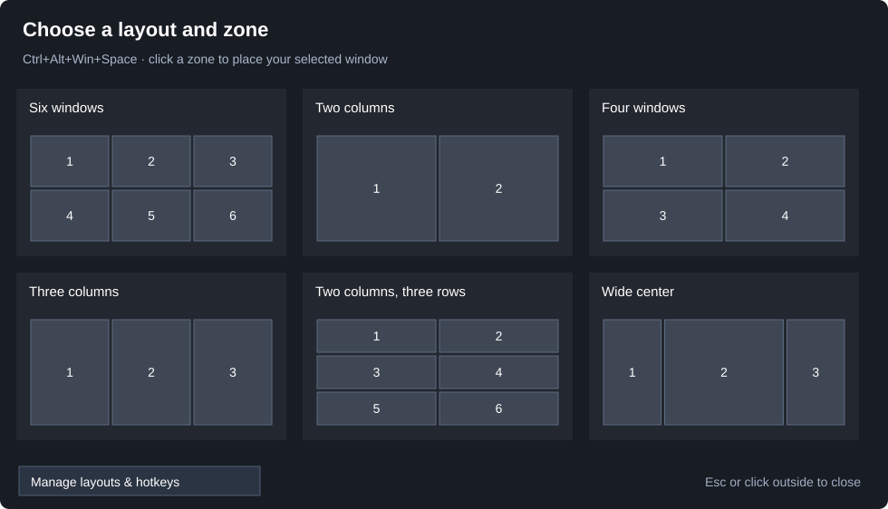

# Windows Tile Studio

A small Windows desktop controller with a persistent custom-layout flyout,
editable layouts and hotkeys, and connected window resizing. Its default
layout is three columns by two rows, with independent row dividers.

**Polish preview.** Keyboard selection, pair-only height resizing, and source
launchers are available. See [the roadmap](docs/ROADMAP.md) for further work.

This is the configurable-layout successor to
[Six Slot Snap](https://github.com/Brandonr91/six-slot-snap), published in a
separate repository so the original six-slot utility remains available.
The current executable and some window titles still use the prototype name
`SixSlotSnap`; the repository is Windows Tile Studio.

Built with C#, Windows Forms, and Windows APIs. No external packages or
replacement taskbar. The current version is an early desktop utility tested
on Windows 11 with a 5120 × 2160 display at 125% scaling.

## Why it was made

An ultrawide desktop had enough room for six useful windows, but placing six
rectangles was only half the problem. Once they were arranged, resizing one
window needed to make its neighbors follow while preserving a usable grid.

The desired behavior was specific: three columns with two windows each;
connected left/right edges across neighboring columns; and a separate
top/bottom divider inside each column. Adjusting the middle column's row
height should not push the left and right columns' row dividers around.

This project grew from that everyday workflow through an iterative Codex
session: keyboard placement first, a visual selector next, then linked
resizing and recovery of all six occupied slots. It is shared so others can
reuse the result, inspect how it works, or use it as a starting point for
their own desktop tools.

**Codex helped build the project; it is not a runtime dependency.** The
controller runs locally without an AI service, API key, or network connection.

## Start

The first polish milestone adds **Start-Hosted.cmd**, which runs the
controller inside Windows PowerShell without generating a standalone app EXE,
and **Get-FromGitHub.ps1**, which installs source into versioned local folders.
See [launch modes](docs/LAUNCHING.md) for instructions, publication requirements,
and tests. The compiled mode below remains available.

Download or clone this repository into a writable folder, then double-click
**Start.cmd**. The first launch compiles the source using the .NET Framework
C# compiler included on compatible Windows installations. The build produces
`bin/SixSlotSnap.exe`.

For a GitHub download, choose **Code → Download ZIP**, extract the ZIP, and
run `Start.cmd` from the extracted folder. Do not run it inside the ZIP.

Alternatively, in PowerShell from the project folder:

```powershell
.\Build.ps1 -Test
.\Start.ps1
```

No installation, administrator privileges, or automatic startup is required.
Only one instance runs in your Windows session. If an older copy is already
running, exit it from its tray icon before starting this copy.

`Start.cmd` uses a process-scoped PowerShell execution-policy argument for
the launcher; it does not change the machine's saved execution policy.
Managed machines may still restrict scripts or compilation.

## Snap a window

Select a window and press **Ctrl+Alt+Win+Space** to open the layout flyout.
Click a zone in any layout to place that window there. The panel stays open
until you select a zone, click outside, press **Esc**, or repeat the shortcut.
The target window remains the one selected when you opened the flyout.

The small **Layouts** button at the top center opens the same panel. It can
be hidden in settings. You can also use **Ctrl+Alt+1** through **Ctrl+Alt+9**
to place the active window in a numbered zone of the current layout.
The default six-window layout is numbered as follows:

| Left | Center | Right |
| --- | --- | --- |
| 1 | 2 | 3 |
| 4 | 5 | 6 |

Choosing a zone in a different layout moves only the selected window. Other
windows stay where they are. Snap those windows into the new layout to join
them to its resizing group.



## Resize the grid

In the flyout, use **arrows** to move the highlighted zone, **Tab/Shift+Tab**
to change layouts, and **Enter** to place the original window. **Escape** closes
the panel. Navigation keys are released when it closes or you switch apps.
If another application reserves a navigation key, mouse selection remains
available and the panel reports that keyboard navigation is unavailable.

- Drag a shared **left/right edge** to resize neighboring columns in both rows.
- Drag a shared **top/bottom edge** to resize that column's two windows.
- Each column keeps its own row divider. A horizontal boundary does not move
  the row dividers in other columns.
- Height dragging affects only the two windows sharing that boundary, from
  either side. Width dragging preserves each window's existing height.
- Moving a window away releases its slot. Snap it again to reconnect it.

The launch scripts save profiles, proportions, and hotkeys in `data/settings.xml`.
The previous file is kept in `data/settings.xml.bak` when replacing settings.
Earlier portable builds used `bin/`; their settings are imported on first use.
An invalid settings file is preserved while defaults run; a warning explains
the recovery. When the controller starts, it
reconnects windows already occupying the saved columns. Current complementary
top/bottom pairs take priority over stale saved row heights. If a window has
moved outside its slot, snap it back using the selector or shortcuts.

The tray menu opens the layout manager, resets proportions in the current
layout, or exits the controller. Exit and delete the project folder to remove it.

## Edit layouts and shortcuts

Open **Manage layouts & hotkeys** from the flyout or tray menu.

1. On **Layouts**, select an existing profile or click **Add layout**.
2. Name it and choose 1–4 columns and 1–4 rows per column, then click
   **Set grid size**. This replaces that profile's current grid dimensions.
3. Edit each column's width weight and comma-separated row weights. For example,
   column widths `1`, `2`, `1` produce a wider center. A column's row weights
   `2, 1` make its top window twice the height of its bottom window. Columns
   can have different numbers of rows.
4. Click **Update preview**, then **Save changes**. Changes to the active
   layout's proportions reposition its managed windows.
5. On **Hotkeys**, use **Change** to choose modifiers and a key for the flyout,
   individual zones, or a specific layout's flyout. Zones 10–16 and per-layout
   shortcuts start unassigned. Duplicate or unavailable shortcuts are rejected;
   an unsuccessful change restores the previously registered shortcuts.

Up to 12 profiles and 16 zones per profile are supported in this basic version.
Six presets are included: six windows, two columns, four windows, three columns,
two columns with three rows, and a wide center.

To carry proportions forward from the original six-slot controller, place its
`layout.txt` beside the new executable before the first launch. It is imported
only when no `settings.xml` exists. Keep the original controller folder if
you want to retain it as a fallback; only one controller can run at a time.

## Current limits

- One monitor is managed at a time; snapping on another monitor switches the
  active layout and clears the previous monitor's window assignments.
- Only the most recently snapped window in each slot participates in resizing.
- App minimum sizes may prevent an exact fit. Minimized and maximized neighbors
  are excluded from linked resizing.
- Elevated apps may require running the controller with matching privileges.
- The selector is a separate panel. This does not add a Windows Snap flyout
  layout or provide drag-to-zone snapping.
- App identities are not saved across app restarts. Recovery uses visible
  geometry, so overlapping duplicate windows may need manual reassignment.
- Full-screen apps, unusual window frames, and additional display configurations
  need broader testing.
- Keyboard navigation needs its temporary keys to be available; a conflict
  keeps mouse selection available without capturing a partial set of keys.
- This version uses rectangular column stacks, not arbitrary overlapping zones.

## Development and verification

The controller is split across `src/`: native window management, layout geometry,
settings persistence, flyout controls, and the settings GUI. Run `Build.ps1 -Test`
to compile it and run geometry/configuration regressions without moving desktop
windows. Tests include all supported grid dimensions, mixed row counts, clamping,
nonzero monitor origins, settings recovery, hotkey validation, and legacy import.

With the controller stopped, run `Build.ps1 -Integration` for the opt-in desktop
suite. It starts a separate controller with isolated settings and six disposable
windows. It checks linked resizing, target preservation, flyout selection,
hotkey cleanup and conflict rollback, and layout-editor saving. It never adopts
existing apps. Geometry tests and controlled desktop checks do not establish
compatibility with every app or every real mouse-drag timing condition.

Actual desktop checks also verified a customized global hotkey, outside-click
dismissal, Escape, and saving a custom layout and shortcut through the GUI.

Before reporting a resizing problem, include the app names, display scaling,
which edge was dragged, and the relevant lines from the data folder's `status.log`.

## Recreate or expand it with Codex

See [Using Codex](docs/USING-CODEX.md) for a recreation prompt, extension
examples, a validation workflow, and ideas for similar native desktop tools.
The repository also includes [AGENTS.md](AGENTS.md), which records the resizing
rules and build command for future coding sessions.

For persistent project context, read [architecture](ARCHITECTURE.md),
[decisions](DECISIONS.md), the current [roadmap](ROADMAP.md), and
[handoff](HANDOFF.md). Consult them together with the actual checkout before
continuing development after a new session or context compaction.

Next steps include per-monitor layouts, minimum-size negotiation, saved app
assignments, and an optional login launcher. These are development ideas rather
than features already implemented; see [the roadmap](docs/ROADMAP.md).

## License and project notes

MIT licensed. See [LICENSE](LICENSE). You can reuse and modify the source
subject to the license terms.

This repository excludes local layout preferences, runtime logs, built
executables, and machine-specific helper scripts. See
[project notes](docs/PROJECT-NOTES.md) for architecture, lessons learned, and
the current verification limits. This is an independent project, not an
official Microsoft or OpenAI product.

